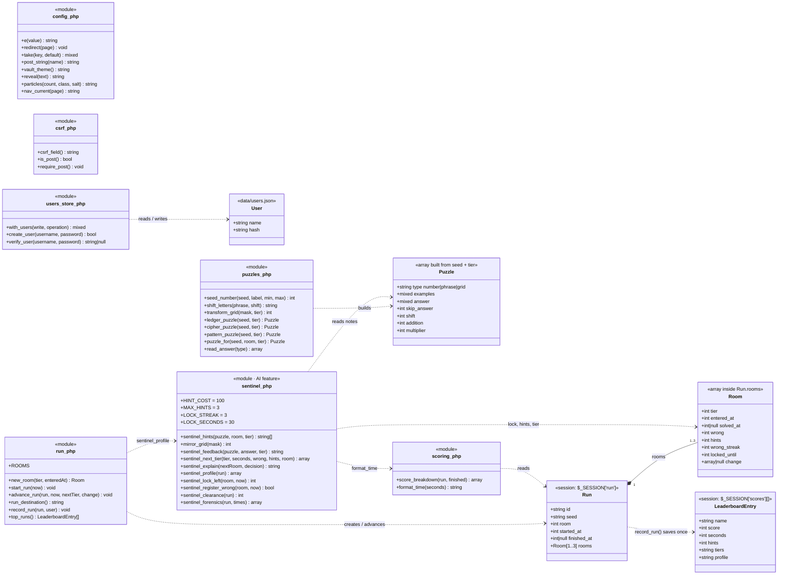

# Program design

Vault Sentinel is written in procedural PHP 8. There are no PHP classes, so the UML below models each `includes/` file as a «module» with its operations, and the session arrays as data classes. Every name matches the code.

## 1. UML class diagram

GitHub renders this diagram directly.



## 2. Page controllers

Each page is a controller. POST handlers always end in `redirect()` (Post/Redirect/Get).

| Page | Guard | Handles | Writes to the session | Goes to |
|---|---|---|---|---|
| `index.php` | none | POST login | `user`, `last_active`, new session ID | `lobby.php` |
| `register.php` | none | POST register | `notice` | `index.php` |
| `lobby.php` | auth | POST start / resume / abandon / theme | `run`, cookie `vault_theme` | `room.php` |
| `room.php` | auth + active run | POST answer | `run.rooms[n]`, `room_feedback`, `door_open` | `room.php` or `escape.php` |
| `hint.php` | auth + POST + room key | POST hint (refused during the lockout) | `run.rooms[n].hints`, `hint_notice` | `room.php` |
| `escape.php` | auth + finished run | GET | `scores[]` (once, guarded by `recorded_runs[runId]`) | — |
| `leaderboard.php` | none | GET | — | — |
| `logout.php` | POST + CSRF | POST | clears the session, expires the cookie | `index.php` |

## 3. Pseudocode

### config.php
```
e(value):            return htmlspecialchars(value, ENT_QUOTES, UTF-8)
redirect(page):      send "Location: page" with status 303; stop
take(key, default):  value ← SESSION[key] or default; delete SESSION[key]; return value
post_string(name):   value ← filter_input(POST, name); return value if string else ""
vault_theme():       t ← COOKIE vault_theme; return t if t in {dark, contrast} else "dark"
reveal(text):        for each word: wrap in <span class="w" style="--i:index">; also output plain text for screen readers
particles(n, class, salt):
                     for i in 0..n-1: h ← crc32(salt + i); emit <i> with x, y, delay, duration, angle, size from h
nav_current(page):   return aria-current="page" if this script is page
```

### csrf.php
```
csrf_field():   if no SESSION.csrf: SESSION.csrf ← 32 random bytes as hex
                return hidden input holding SESSION.csrf
is_post():      return request method = POST
require_post(): if not POST: respond 405 and stop
                if POST csrf ≠ SESSION.csrf (constant-time compare): respond 403 and stop
```

### auth_guard.php
```
if SESSION.user missing: SESSION.notice ← "Please log in"; redirect index.php
if now − SESSION.last_active ≥ 1800: clear session; new session ID; SESSION.notice ← "timed out"; redirect index.php
SESSION.last_active ← now
```

### users_store.php
```
with_users(write, operation):
    open data/users.lock; lock it (exclusive if write, shared otherwise)
    users ← decode data/users.json (or empty)
    result ← operation(users, path); unlock; return result

create_user(username, password):
    with_users(write):
        key ← lowercase(username)
        if key exists: return false
        users[key] ← {name, hash: password_hash(password)}
        write JSON to a temp file; rename it over users.json (atomic)
        return true

verify_user(username, password):
    user ← users[lowercase(username)]
    if user missing or not password_verify(password, user.hash): return null
    return user.name
```

### puzzles.php
```
seed_number(seed, label, min, max):  n ← first 7 hex digits of sha256(seed:label); return min + n mod (max−min+1)
shift_letters(phrase, shift):        for each letter A–Z: move it shift places, wrapping around
transform_grid(mask, tier):
    for each filled cell (row, col):
        tier 1: move to (row, col+1 mod 3)        // slide right
        else:   move to (col, 2−row)              // quarter turn clockwise
    if tier = 3: flip every cell                  // swap filled and empty
ledger_puzzle(seed, tier):
    start, add, mul ← seed_number(...)
    repeat 6 times:
        tier 1: next ← last + add
        tier 2: next ← last × mul + add
        tier 3: next ← last + add on even steps, last × mul on odd steps
    return examples = first 5 terms, answer = 6th, skip_answer = 7th, add, mul
cipher_puzzle(seed, tier):
    pick a phrase list and shift range for the tier; pick phrase and shift from the seed
    return examples = shift_letters(phrase, shift), answer = phrase, shift, range
pattern_puzzle(seed, tier):
    first ← one corner + one edge; second ← transform(first); third ← transform(second)
    return examples = [first, second, third], answer = transform(third)
puzzle_for(seed, room, tier): room 1 → ledger, 2 → cipher, 3 → pattern
read_answer(type):
    grid:   each cells[] value must be "0".."8" and unique → bit mask (no cells = empty grid)
    number: filter_input VALIDATE_INT, else null
    phrase: letters and single spaces only → uppercase, else null
    return [answer or null, the player's raw input to refill the form]
```

### run.php
```
new_room(tier, t):   return {tier, entered_at: t, solved_at: null, wrong: 0, hints: 0, wrong_streak: 0, locked_until: 0}
start_run(now):      SESSION.run ← {random id, random seed, room 1, started_at: now, rooms: [1 → new_room(2, now)]}
advance_run(run, now, nextTier, change):
    rooms[current].solved_at ← now
    if current is room 3: run.finished_at ← now; return
    room ← room + 1; rooms[room] ← new_room(nextTier, now) plus change (Sentinel's reason)
run_destination():   no run → lobby.php; finished → escape.php; else → room.php
record_run(run, user):
    if not finished or recorded_runs[run.id] is set: return     // saves each run exactly once
    recorded_runs[run.id] ← true
    append {name, score, seconds, total hints, tiers, profile} to SESSION.scores
top_runs():          sort SESSION.scores by score desc, then seconds asc; return the first 10
```

### scoring.php
```
score_breakdown(run, finished):
    base 1000; −50 × wrong answers; −100 × hints
    time bonus ← clamp((600 − seconds) × 10, 0, 500) if finished
    tier bonus ← Σ over solved rooms of 75 × (tier − 1)
    total ← max(0, sum)
format_time(s): return "m:ss"
```

### sentinel.php (the AI feature)
```
sentinel_hints(puzzle, room, tier):  return 3 hints for this room and tier, from a nudge to a near give-away

sentinel_feedback(puzzle, answer, tier):
    number: answer = skip_answer → "one step ahead"; answer > target → "too high"; else "too low"
    phrase: for back in 1..25: if decoding the cipher back by that many places gives the answer:
                back ≤ 13 → "right direction, wrong amount"; else → "wrong way"
            otherwise → "k of n words are right", or a plain "not quite"
    grid:   if tier ≥ 2 and answer = mirror(last grid) (flipped for tier 3) → "you mirrored instead of turning"
            else → "k of 9 cells are right"

sentinel_next_tier(tier, t, w, h, room):
    if t < 60 and h = 0 and w ≤ 1:        next ← min(3, tier + 1)
    else if t > 180 or h ≥ 2 or w ≥ 4:    next ← max(1, tier − 1)
    else:                                 next ← tier
    return {next, reason, direction}
sentinel_explain(nextRoom, decision):  "Room N moves up to / drops to / stays at Tier X because <reason>."

sentinel_profile(run):
    if total hints ≥ 2: "Hint-Reliant"
    else if run time < 300 s: "Speed Runner"
    else: "Methodical Solver"

sentinel_lock_left(room, now):  return max(0, locked_until − now)
sentinel_register_wrong(room, now):
    wrong++; wrong_streak++
    if wrong_streak ≥ 3: wrong_streak ← 0; locked_until ← now + 30; return true
    return false
sentinel_clearance(run):
    c ← 50
    for each room: c −= 5 × wrong + 10 × hints; if solved with 0 wrong and 0 hints: c += 15
    return clamp(c, 0, 100)

sentinel_forensics(run, times):                   // graduate post-game report
    slowest ← room with the most seconds; fastest ← room with the fewest
    hint_room ← room with the most hints (none if no hints were used)
    sentences:
        fastest = slowest → "about the same time in every room"; else "quickest in A, slowest in B"
        wrong = 0 → "never submitted a wrong answer"; wrong ≥ 4 → "tests ideas on the lock"; else "corrected course"
        hints = 0 → "no hints"; else "k hints, most in hint_room"
        highest tier = 3 → "reached Tier 3"; else "a faster, hint-free room would push you higher"
    return {slowest, hint_room, summary}
```

### hint.php
```
require login, POST with CSRF token, an unfinished run, and a matching room key
if sentinel_lock_left(room) > 0: "Suspicious activity detected", nothing deducted   // brute-force detector
else if hints < 3: hints++ (score_breakdown charges 100)
else: "No hints left", nothing deducted
redirect room.php
```

### room.php (the answer handler)
```
require login and an unfinished run
puzzle ← puzzle_for(seed, room, tier)
on POST:
    require_post(); room_key must match run id + room number, else reload
    if sentinel_lock_left > 0: show "sealed", no penalty; redirect
    [answer, input] ← read_answer(type)
    if answer = puzzle.answer:
        if not the last room: decision ← sentinel_next_tier(...); reason ← sentinel_explain(...)
        advance_run(run, now, decision.tier, reason)
        if finished: record_run(); flag the door animation; redirect to run_destination()
    else if answer is null: validation message, no penalty
    else: message ← sentinel_feedback(...) + "50 points deducted"
          if sentinel_register_wrong(): add "sealed for 30 seconds"
    redirect room.php                             // Post/Redirect/Get
```
